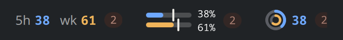
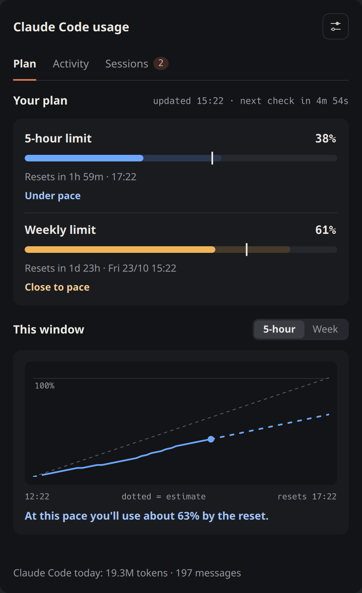
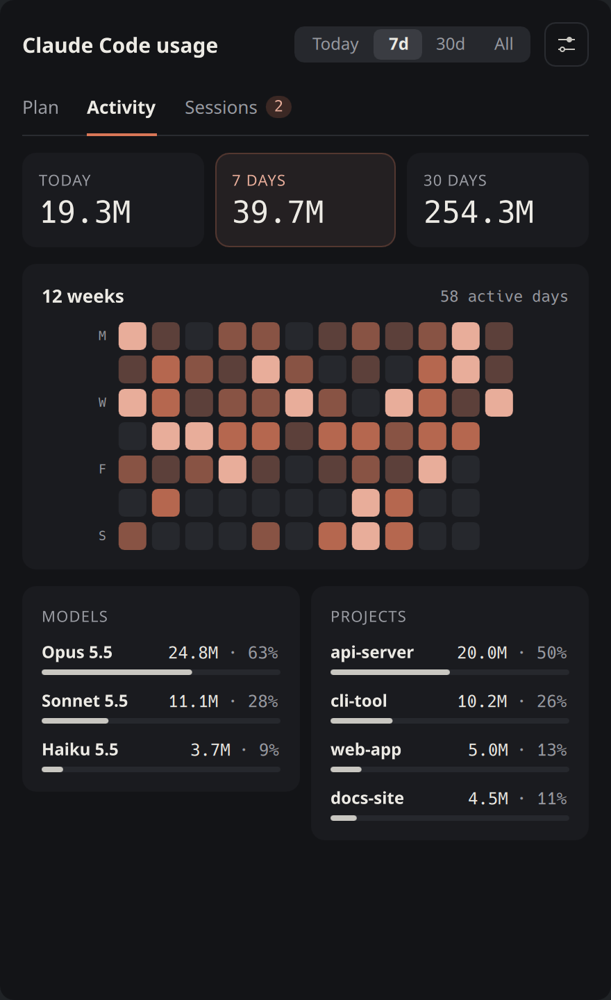
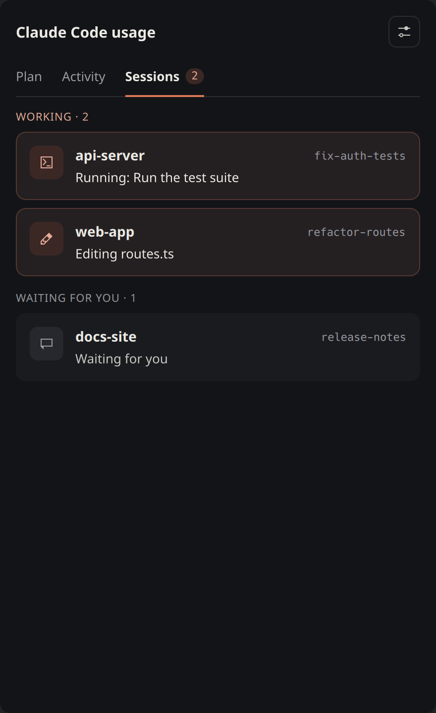
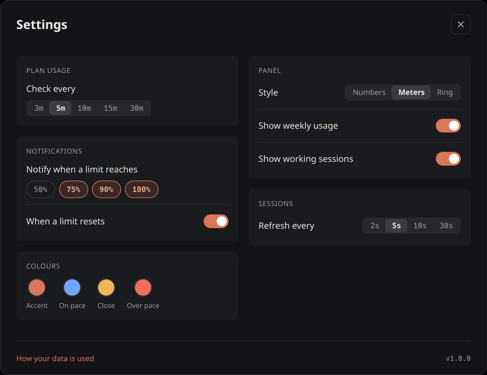

# Claude Code Usage Tracker

[](https://github.com/imdizmo/claude-usage-tracker/actions/workflows/test.yml)

See your Claude Code plan limits on the Linux desktop: how much of the 5-hour
and weekly limits you've used, when each one resets, and whether you're on pace
to run out before it does.

<p align="center">
  
</p>
<p align="center">
  
  
  
</p>
<p align="center"><sub>Screenshots use demo data.</sub></p>

> **Unofficial.** This project is not affiliated with or endorsed by Anthropic.
> It reads an undocumented endpoint (`/api/oauth/usage`) that Claude Code itself
> uses, which may change or disappear without notice.

It ships two independent front-ends over the same data:

| | What it is | Pick it if |
|---|---|---|
| **Plasma applet** (`plasmoid/`) | Native KDE Plasma 6 panel widget with a full popup | You use KDE Plasma 6 |
| **Tray widget** (`usage_tray.py`) | PySide6 system-tray icon and a small always-on-top overlay | You use any other desktop with a system tray |

## Features

Colours follow the **pace verdict**, not the raw percentage: blue when you're
under pace, amber when you're close, red when you're on track to hit the limit
before it resets. All three, and the orange accent, can be changed in the
applet's settings.

**In the panel**, in one of three styles: *Numbers* (`5h 38 wk 61`), *Meters*
(two small bars with an even-pace tick) or *Ring* (two rings, square enough for a
vertical panel). The widget dims when it's showing a cached reading, and a
pulsing count appears while Claude Code sessions are working.

**In the applet's popup:**

- **Plan**: both limits, each bar with an even-pace tick and a faded forecast
  of where you'll be at reset, then a chart of the current 5-hour or weekly
  window with a plain verdict ("At this pace you'll use about 63% by the reset").
- **Activity**, read from Claude Code's local logs on this computer: tokens for
  today, 7 and 30 days, a 12-week activity grid, and models and projects ranked
  by tokens for today, 7 days, 30 days or all time.
- **Sessions**: every running Claude Code session, working ones first, and what
  each is doing right now (`Editing routes.ts`, `Running: <command>`,
  `Thinking`, `Waiting for you`).
- **Desktop notifications** when a limit crosses 75%, 90% or 100% (configurable),
  and when a window you were warned about resets.
- **Plain-language errors**: "Login expired: open Claude Code once to refresh
  it", "Usage endpoint is rate-limiting: will retry on the next poll", and so
  on, with the last good reading still on screen.

**The tray widget** shows the 5-hour percentage as its icon, coloured green to
red, with both limits and their reset countdowns in the tooltip and the overlay.
Left-click toggles the overlay; right-click has *Refresh now*, *Show/hide panel* and *Quit*.

## Requirements

- Linux.
- [Claude Code](https://docs.anthropic.com/en/docs/claude-code) installed and
  signed in with a Claude subscription (Pro, Max, Team or Enterprise). API-key logins have no plan
  limits, so there's nothing to show.
- Python 3.11 or newer.
- **Applet:** KDE Plasma 6. No Python packages beyond the standard library.
- **Tray widget:** a desktop with a system tray. PySide6 (Qt 6 for Python) is used from your distribution, or installed automatically.
- Optional: `notify-send` (package `libnotify`) for the applet's desktop
  notifications.

## Install

```sh
git clone https://github.com/imdizmo/claude-usage-tracker.git
cd claude-usage-tracker
./install.sh applet   # KDE Plasma 6: the panel widget
./install.sh tray     # any other desktop: the tray widget
```

Both install for your user only, with no root needed. Run the same command again to
update after pulling new changes.

**Applet.** Then right-click your panel, choose **Add Widgets…**, and drag
**Claude Code Usage** onto it.

**Tray.** It starts at login from then on. To start it right away:

```sh
claude-usage-tray &
```

It uses your distribution's PySide6 if it's installed (`pacman -S pyside6`,
`apt install python3-pyside6.qtwidgets`, `dnf install python3-pyside6`).
Otherwise the installer puts PySide6 in a private environment under
`~/.local/share/claude-usage-tracker/` (about 260 MB).

To try the tray without installing anything, run `python3 usage_tray.py` from
the repository.

## Configuration

Applet settings live in its own window: the gear icon in the popup, or
right-click the applet and choose **Settings…**. Changes apply immediately.

<p align="center">
  
</p>

| Setting | Default | |
|---|---|---|
| Check plan usage every | 5 minutes | 3, 5, 10, 15 or 30 minutes. The endpoint rate-limits quickly; below 5 minutes you'll see more cached readings. |
| Notify when a limit reaches | 75%, 90%, 100% | Any of 50 / 75 / 90 / 100%. |
| Notify when a limit resets | on | Only for windows you were warned about. |
| Panel style | Meters | Numbers, Meters or Ring. |
| Show weekly usage | on | In the panel. |
| Show working sessions | on | The pulsing count in the panel. |
| Refresh session status every | 5 seconds | Local files only, no network. |
| Colours | orange accent; blue, amber, red | Accent, on pace, close, over pace. Click a swatch to pick; **Reset to defaults** undoes it. |

The tray widget has no settings. It checks every 5 minutes and leaves
notifications to the applet.

## How it works

**Plan limits.** Every few minutes it calls
`GET https://api.anthropic.com/api/oauth/usage` with the OAuth token Claude Code
already stores in `~/.claude/.credentials.json`. There's no API key and nothing
to log into: if Claude Code works on this computer, this works.

**Rate limiting.** That endpoint returns HTTP 429 if it's polled too often. On
any failure (429, offline, expired login) both front-ends show the last good
reading, marked as cached, and keep the reset countdowns ticking from the cached
reset times. If you run both, the tray reuses a reading the applet made in the
last few minutes instead of making a second request.

**Claude Code activity.** The *Claude Code* tab reads the session logs in
`~/.claude/projects/**/*.jsonl` and the session files in `~/.claude/sessions/`.
The first scan can take a few seconds on a large history. After that, only
newly appended lines are read.

## Privacy

- **Network:** the only request is the one above, to `api.anthropic.com`.
  Nothing else leaves your computer. There is no telemetry.
- **Credentials:** `~/.claude/.credentials.json` is only ever read, never
  written, copied or logged.
- **Stored locally:** in `~/.cache/`:
  - `claude-usage.json`: the last usage reading.
  - `claude-usage-state.json`: a week of usage readings and which alerts were sent.
  - `claude-usage-stats.json`: per-day token counts by model and project
    folder name, plus how far each log file has been read.

  Conversation content is never stored. Delete these files at any time to reset
  history, alerts and the log scan.

## Troubleshooting

| You see | What to do |
|---|---|
| *Claude Code isn't signed in on this machine* | Run `claude` and log in. |
| *No Claude.ai login in ~/.claude/.credentials.json* | You're signed in with an API key, which has no plan limits. Log in with a Claude.ai account instead. |
| *Login expired: open Claude Code once to refresh it* | Start Claude Code once. The widget re-reads the token on every check and recovers on its own. |
| *Usage endpoint is rate-limiting* | Nothing; it retries on the next check. If it happens often, check less frequently. |
| Numbers dimmed, "Showing the reading from HH:MM" | A cached reading is being shown. The reason is shown next to it. |
| Tray: *No system tray available* | Your desktop has no system tray. On GNOME, install the AppIndicator extension. |
| Tray overlay in the wrong place on Wayland | The tray runs under XWayland (`QT_QPA_PLATFORM=xcb`) so it can position the overlay. Drag it where you want it. |

## Uninstall

```sh
./install.sh uninstall
```

This removes the applet, the tray, its launcher and its autostart entry. Your
cached readings are kept; delete them with `rm -f ~/.cache/claude-usage*.json`.

## Development

```
plasmoid/
  metadata.json            applet metadata
  contents/code/fetch.py   all data work: API, cache, alerts, log scan, live sessions
  contents/config/main.xml settings and their defaults
  contents/ui/             QML: main.qml (panel + popup), PlanPage, ActivityPage,
                           SessionsPage, SettingsWindow, Theme.js (palette),
                           Colours.qml (user colours) and small shared components
usage_tray.py              PySide6 tray front-end; imports fetch.py
install.sh                 install / update / uninstall / test
docs/                      README screenshots
```

`fetch.py` is a stand-alone command-line script; the applet runs it and reads its
JSON output:

```sh
python3 plasmoid/contents/code/fetch.py           # plan usage (also sends alerts)
python3 plasmoid/contents/code/fetch.py --stats   # Claude Code activity from local logs
python3 plasmoid/contents/code/fetch.py --live    # running sessions
```

**Tests.** The self-tests use only temporary files. They don't touch your
`~/.claude` or `~/.cache` and make no network requests:

```sh
./install.sh test
```

To try the applet without adding it to your panel, use `plasmoidviewer` from
the `plasma-sdk` package:

```sh
plasmoidviewer -a plasmoid
```

[Issues](https://github.com/imdizmo/claude-usage-tracker/issues) and pull requests are welcome. Please run `./install.sh test` before sending
a change.

## License

MIT. See [LICENSE](LICENSE).
